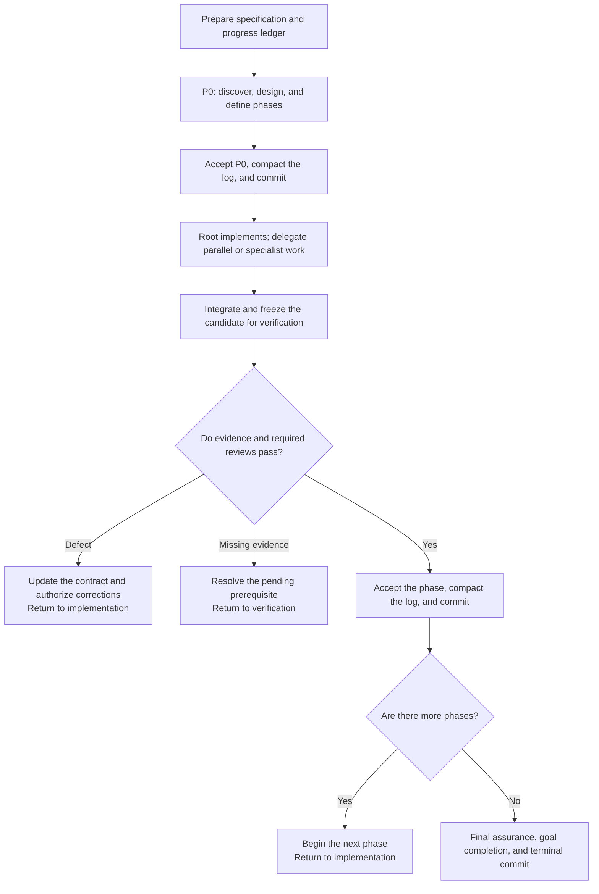

# Code Craft

**Give complex implementations a clear path to completion.**

Code Craft is an orchestration skill for Codex that takes a feature request through planning, implementation, review, and delivery. The lead agent defines the technical direction, implements the main work, and delegates bounded assignments when parallel execution or a specialist's method helps. It brings the result together against explicit completion criteria.

It is built for work that needs sustained attention: features spanning several components, changes with subtle failure paths, and implementations that continue across sessions. You provide the objective and constraints. The lead agent coordinates the agents, follows up on gaps, and keeps a record of what is ready, what is verified, and what still needs work.

## Keep the whole implementation moving

A feature often spans design decisions, coordinated code changes, and integration checks. Code Craft gives those responsibilities a common workflow, with one lead agent accountable for the result.

- **A plan grounded in your project.** The lead agent examines the existing code and requirements, defines component responsibilities, and breaks the work into phases with observable outcomes.
- **Focused execution.** The lead agent implements a single general assignment directly. When useful independent work is available, it takes one assignment and delegates others. Specialists handle cores that benefit from their methods. Every implementer has a clear scope, relevant sources, and ownership of specific files or systems.
- **Review built into the plan.** Verification requirements are chosen before implementation. The evidence needed to accept a phase is part of the assignment from the start.
- **Corrections carried through.** The lead agent evaluates findings, coordinates fixes, and checks the affected behavior again before accepting the work.
- **Progress you can inspect and resume.** A persistent ledger and phase commits connect the implementation to its decisions, validation results, and next steps.

Routine technical choices stay with the agents. Questions return to you when a missing decision materially affects the approved scope or required behavior and cannot be resolved from the available sources.

## Model selection for delegated work

Code Craft assesses each assignment's reasoning difficulty, material uncertainty, coupled guarantees, and required verification depth, then selects the model and effort together. The most demanding necessary obligation governs the selection; consequences of error inform the assurance needed. Cost and latency are optimized among suitable configurations.

The lead agent implements with its runtime configuration when it fits that assessment and delegates a coherent assignment when it does not. It retains responsibility for architecture, scope, integration, and acceptance. Coordination that unblocks other agents takes priority over its local implementation. For runs intended to use Sol for most development, select GPT-6.1 Sol for the lead agent at startup; delegated routing does not change that configuration.

| Model | Delegated work | Delegated effort |
| --- | --- | --- |
| **GPT-6.1 Sol** | Default for general development, investigation, and independent review, including complex work supported by established methods, coherent decomposition, and analysis of interactions. | `low` through `max` |
| **GPT-6 Luna** | Factual collection, eligible prescribed command execution, and strictly mechanical implementation with an explicit approach, limited interpretation, and directly checkable results. | `medium` through `xhigh` |
| **GPT-6 Astra** | Exceptionally difficult inference, derivation, reconciliation of competing explanations, or global judgment over tightly coupled guarantees whose premises must also be established or challenged. | `low` through `xhigh` |

Prefer Sol at the Luna–Sol boundary. Luna implementation requires an explicitly determined transformation, localized and well-understood effects, and no behavioral design, diagnosis, or nontrivial technical choices. Analytical investigation follows the same reasoning criteria as development and review. Sol remains the default for complex work; Astra is selected for a concrete exceptional reasoning obligation, without a frequency quota or a requirement to exhaust Sol.

For Astra or effort `high` and above, briefly record the decisive reasoning obligations and expected evidence benefit in the existing ledger. Identify what must be related, discovered, or established. Prior attempts and proof that another configuration would fail are unnecessary. Size, duration, technology, role, or a previous failure alone cannot determine the configuration.

Implementation and review select their configurations independently from their own obligations. The same criteria apply to general, specialist, correction, and final reviews, including the need to discover failures, challenge premises, and establish guarantees throughout the authorized scope.

Effort reflects the depth required within the model: `low` for a defined approach and few interactions; `medium` for local choices, interacting rules, and known failure paths; `high` for substantial joint analysis with sufficiently established premises; `xhigh` for sustained investigation of material premises, competing explanations, or difficult interactions; and Sol's `max` for particularly deep exploration and verification through alternatives, systematic counterexamples, and reconciliation of evidence. These criteria apply to focused and broad assignments. Effort is relative to the model: Sol at `max` has no prescribed Astra equivalent and is not a prerequisite for Astra. The [delegation policy](skills/code-craft/references/delegation.md#effort-selection) defines the criteria and limits; `ultra` is excluded from delegated work.

The role and model are selected separately. A general implementer handles ordinary application work; specialists can take on algorithmic cores or state transitions when their methods help establish correctness. General and security reviewers assess the relevant behavior independently.

Commands and validation needed to complete an assignment stay with its executor. The lead agent runs other standalone commands directly, including quick commands.

Agents receive self-contained or bounded assignment context; full conversation history is excluded. Fresh reviewers start without inherited conversation or earlier verdicts. This keeps context focused and gives reviews an independent basis in the requirements, code, and evidence.

The approach aims to use compute efficiently by limiting duplicated context and matching reasoning effort to the work. Actual cost and speed depend on the task, available parallelism, and the amount of review and correction required.

## From request to delivery

The workflow advances through accepted outcomes. Every phase has a purpose, dependencies, and evidence that determines whether it is ready to close.



1. **Understand and design.** The lead agent establishes the goal, reads the requirements, and investigates the project in an initial discovery phase, P0. It defines the solution, identifies uncertain assumptions, and maps requirements to implementation phases and acceptance evidence.
2. **Assign and implement.** Once a phase's dependencies are accepted and recorded, the lead agent selects the executors, implementing general work itself and delegating useful parallel or specialist assignments. It records its own scope and obligations in the ledger and supplies contracts to subagents. All writers have separate ownership; delegated implementers bring architectural or scope gaps back to the lead agent for resolution.
3. **Integrate and verify.** The lead agent combines the changes and holds the version under review stable. Validation and any required independent reviews are tied to that version, so acceptance reflects the actual deliverable.
4. **Correct and checkpoint.** Confirmed defects lead to focused corrections and renewed verification of affected behavior. The lead agent consolidates the phase's log into a summary, then commits the accepted changes and prepared progress record together before dependent work begins.
5. **Check the complete result.** The lead agent evaluates cumulative requirements coverage and interactions between phases. When valid evidence establishes the final obligations, it confirms coverage directly. Any required independent final review uses a dedicated final-assurance phase or a planned final integration phase covering those obligations. It then closes the goal and final checkpoint. The handoff explains the changes, validation, and remaining limitations.

Phase checkpoints use local Git commits when a repository exists and there are changes to record. They provide a history of accepted work and a basis for recovery after interruptions.

## Verification proportional to the work

Code Craft selects each phase's verification mode and acceptance obligations before its first implementation change; read-only work requires that decision before acceptance. Each assignment receives its share of those obligations, while acceptance covers the phase as a whole.

Root evidence can establish bounded, local, reversible work through reproducible checks. Material boundary changes or acceptance requiring substantive judgment need independent general review. Specialist review is added when an in-scope boundary presents a reachable material failure mode that root evidence and general review cannot adequately assess. These criteria cover existing behavior in read-only work as well as changes; a confirmed defect is not required to select a specialist. The [verification selection policy](skills/code-craft/references/delegation.md#select-verification-before-writes) defines these modes. The same requirements apply when the lead agent implements the work.

Review findings distinguish confirmed defects from missing evidence and optional improvements. Required evidence must be established before acceptance; suggestions do not automatically expand the scope. Keep the same reviewer through scope updates and corrections while its configuration remains suitable and it remains available and independent. Reassess the configuration when discoveries materially change reasoning difficulty, uncertainty, coupled guarantees, or required verification depth; rejection alone does not justify changing model or effort. Replacements preserve independence and required coverage. Unaffected review evidence is retained with a brief justification instead of repeating the entire review portfolio. Existing checks are reused when they remain valid, and new tests are added only when explicitly required or justified as indispensable.

This gives the implementation a defined correction loop: identify the failed obligation, fix it within scope, and verify the affected result. If the same guarantee fails again after a correction, the lead agent revisits the underlying assumption and equivalent paths before another attempt, briefly recording the corrected rule in the existing ledger. Unresolved blockers remain visible in the progress record.

Before deciding on additional final review, the lead agent fills evidence gaps through reproducible checks within its authority and the applicable verification mode. An unavailable check remains pending; missing evidence alone does not require another reviewer. Independent final review is required for outstanding substantive judgment or an independent review obligation not yet satisfied by valid evidence. High risk alone does not require repeating an already sufficient review. Its phase records the outstanding guarantees, the evidence gap, and acceptance evidence. Defects reopen the affected implementation phases for correction, while the final review phase waits in `Blocked`. Once corrections are accepted and committed, the same final reviewers resume against the corrected candidate and reuse unaffected evidence. Corrections owned by a final integration phase follow its own correction cycle. Completed final assurance is reused at run completion while its evidence remains valid.

## A record that supports the next session

Long implementations need continuity. Code Craft keeps requirements, technical decisions, and execution progress in a small set of documents:

| Document | What it gives you |
| --- | --- |
| **Specification** | The source of requirements and acceptance criteria. A supplied specification is reused; otherwise, the user's requirements are captured in `docs/PLAN-SPECS-{context-id}.md`. |
| **Design** | New material shared technical decisions and their rationale in `docs/PLAN-DESIGN-{context-id}.md`, created only when existing sources do not establish them. Local implementation details stay in code and assignment contracts. |
| **Progress ledger** | The plan, phase status, active responsibilities, essential evidence, blockers, and next actions in `.code-craft/PLAN-PROGRESS-{context-id}.md`. |

The specification stays protected unless you explicitly request edits to it. Technical decisions remain traceable to the requirements they serve.

On resume, the lead agent reconciles these records with the actual workspace, goal, and agent state. Valid completed work can be reused, while changed or uncertain evidence is checked before execution continues.

## Try it on your next implementation

With the skill and required agent roles available in Codex, describe the outcome:

```text
Use $code-craft to implement [objective] in this project.
```

An existing specification gives the run a clear starting point:

```text
Use $code-craft to implement the CSV export feature described in docs/export-spec.md.
Follow the existing authorization rules and preserve the current report API.
```

You can also start from a feature description. Include the behavior you need, important constraints, and what would count as a successful result; the lead agent uses those sources to establish the implementation plan.

The workflow requires runtime goals, subagents, and access to the configured models and roles.

Code Craft is a good fit for features spanning multiple components, work with meaningful integration or recovery risks, and longer tasks that benefit from checkpoints. Small, straightforward edits usually need less coordination.

## Repository contents

| Path | Contents |
| --- | --- |
| [skills/code-craft/SKILL.md](skills/code-craft/SKILL.md) | Main skill definition and operating rules. |
| [skills/code-craft/references/](skills/code-craft/references/) | Detailed workflow policies and assignment templates. |
| [skills/code-craft/agents/openai.yaml](skills/code-craft/agents/openai.yaml) | Skill metadata and default prompt. |
| [agents/](agents/) | Agent configurations for specialized implementation, general review, and security review. |
